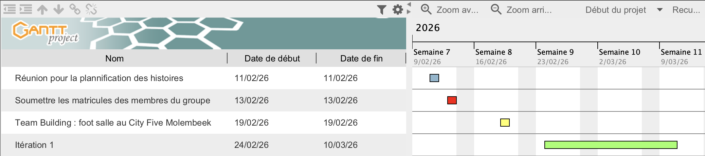
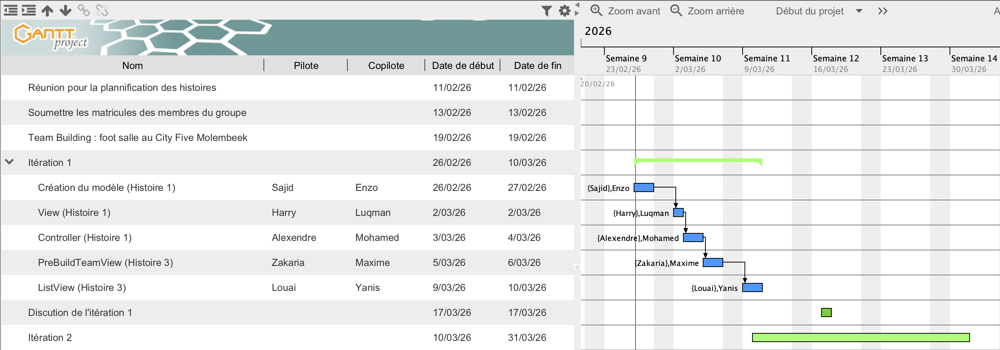
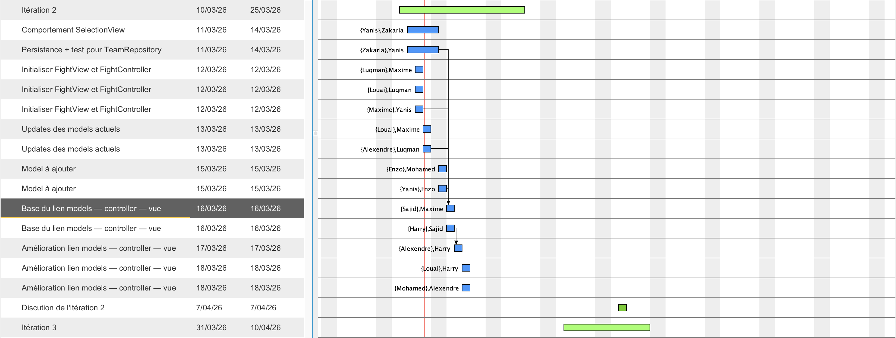
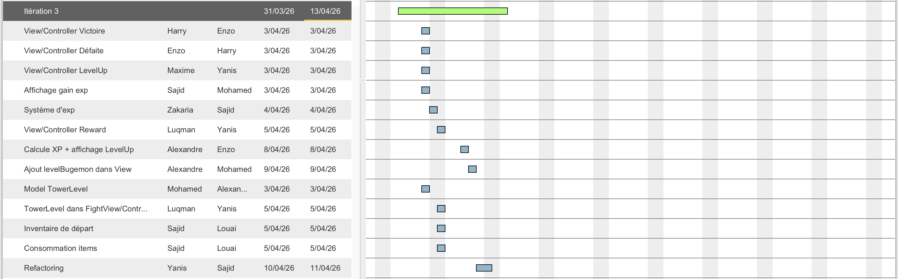
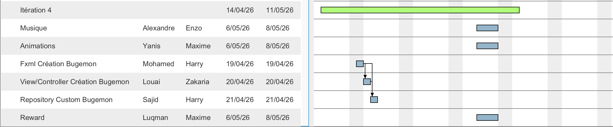

# Répartition des tâches développeur

- Groupe : 05
- Date : 02/04/2026

### Sommaire

- [Itération 0](#itération-0)
- [Itération 1](#itération-1)
- [Itération 2](#itération-2)
- [Itération 3](#itération-3)
- [Itération 4](#itération-4)

## Itération 0
### Plan d'ensemble

### Tâches
- Team Building : foot salle au City Five Molembeek
- Choix des heures et risques pour les histoires
### Discussions de contenu
Pendant notre réunion facultative du mercredi 11 février à 12h nous avons mis en commun nos choix pour les risques et les heures pour chacune des histoires à l'aide d'un Google Forms et avec le tableau Google Sheets associé, on a pu calculer une moyenne de risque et d'heure pour chaque tâche ainsi que de calculer la durée totale pour établir les 28 histoires.

### Risques et problèmes

Nous n'avons pas pu tous être présent durant cette réunion facultative, car elle a été programmé la veille, mais pour palier cela, on a enregistré la discussion sur le dictaphone.

___
## Itération 1
### Plan d'ensemble

### Tâches
<table>
    <tbody>
        <tr><td>Vélocité :</td><td>28</td></tr>
        <tr><td>Total Points réel :</td><td>30</td></tr>
        <tr><td>Total Points estimé :</td><td>34</td></tr>
    </tbody>
</table>

<table>
  <thead>
    <tr>
      <th colspan="5" style="text-align: center;">HISTOIRE 1</th>
    </tr>
    <tr>
      <th>Tâches</th>
      <th>Pilote</th>
      <th>Copilote</th>
      <th>Points réels</th>
      <th>Points estimés</th>
    </tr>
  </thead>
  <tbody>
    <tr><td>Lecture du fichier bugémon.json et création modèle (Model)</td><td>Sajid</td><td>Enzo</td><td>7</td><td>8</td></tr>
    <tr><td>Création d'une page de la selection des Bugémons avec des boutons (View)</td><td>Harry</td><td>Luqman</td><td>6</td><td>5</td></tr>
    <tr><td>Fonctionnement du mécanisme de selection + affiche les infos lors du passage de la souris sur le Bugémon</td><td>Alexandre</td><td>Mohamed</td><td>6</td><td>8</td></tr>

  </tbody>
</table>

<table>
  <thead>
    <tr>
      <th colspan="5" style="text-align: center;">HISTOIRE 3</th>
    </tr>
    <tr>
      <th>Tâches</th>
      <th>Pilote</th>
      <th>Copilote</th>
      <th>Points réels</th>
      <th>Points estimés</th>
    </tr>
  </thead>
  <tbody>
    <tr><td>PreBuildTeamView pour afficher les équipes déjà faites sur une nouvelle fenêtre </td><td>Zakaria</td><td>Maxime</td><td>6</td><td>6</td></tr>
    <tr><td>ListView permettant de sélectionner et de supprimer les équipes</td><td>Louai</td><td>Yanis</td><td>5</td><td>7</td></tr>
  </tbody>
</table>

### Discussions de contenu

Le 25 février, nous nous sommes réunies sur Teams pour répartir les tâches.

Lors de la première réunion avec le client, nous avons mis au clair les détails des histoires 1 et 3 qu'on devra faire pour cette première itération.

### Risques et problèmes

Nous avons eu du mal à séparer les tâches de manière équitable. Donc, on va faire en sorte que les personnes qui ont eu des tâches compliquées, auront des tâches plus simples aux prochaines itérations.

À cause du peu d'histoire qu'on a eu pour cette itération en conséquence de la surestimation des points des histoires, on a séparé les histoires en trop petites histoires ce qui a conduit au fait que certaines personnes ont fait des taches qui ne l'était pas attribué en pensant faire la leur.
Pour palier à celà, on va réduire les points sur notre histoire afin d'en avoir plus durant la prochaine itération et éviter de séparer les tâches en tâches futiles.
___
## Itération 2
### Plan d'ensemble

### Tâches
<table>
    <tbody>
        <tr><td>Vélocité :</td><td>28</td></tr>
        <tr><td>Total Points réel :</td><td>34</td></tr>
        <tr><td>Total Points estimé :</td><td>28</td></tr>
    </tbody>
</table>

<table>
  <thead>
    <tr>
      <th colspan="5" style="text-align: center;">HISTOIRE 2</th>
    </tr>
    <tr>
      <th>Tâches</th>
      <th>Pilote</th>
      <th>Copilote</th>
      <th>Points réels</th>
      <th>Points estimés</th>
    </tr>
  </thead>
  <tbody>
    <tr><td>Comportement SelectionView (à faire pour le 14/03 max) </td><td>Yanis</td><td>Zakaria</td><td>1,5</td><td>1,5</td></tr>
    <tr><td>Persistance + test pour TeamRepository (à faire pour le 14/03 max)</td><td>Zakaria</td><td>Yanis</td><td>1,5</td><td>1,5</td></tr>
  </tbody>
</table>

<table>
  <thead>
    <tr>
      <th colspan="5" style="text-align: center;">HISTOIRE 4</th>
    </tr>
    <tr>
      <th>Tâches</th>
      <th>Pilote</th>
      <th>Copilote</th>
      <th>Points réels</th>
      <th>Points estimés</th>
    </tr>
  </thead>
  <tbody>
    <tr><td>Initialiser FightView et FightController (12/03 10h-11h)</td><td>Luqman</td><td>Maxime</td><td>1</td><td>1</td></tr>
    <tr><td>Initialiser FightView et FightController (12/03 12h-14h)</td><td>Luqman</td><td>Louai</td><td>2</td><td>2</td></tr>
    <tr><td>Initialiser FightView et FightController (12/03 17h-18h)</td><td>Maxime</td><td>Yanis</td><td>2</td><td>1</td></tr>
    <tr><td>Updates des models actuels et ajout de nouveau models (13/03 10h-12h)</td><td>Louai</td><td>Maxime</td><td>3</td><td>2</td></tr>
    <tr><td>Base du lien models — controller — vue (16/03 17h-19h)</td><td>Sajid</td><td>Maxime</td><td>3</td><td>2</td></tr>
</tbody>
</table>

<table>
  <thead>
    <tr>
      <th colspan="5" style="text-align: center;">HISTOIRE 5</th>
    </tr>
    <tr>
      <th>Tâches</th>
      <th>Pilote</th>
      <th>Copilote</th>
      <th>Points réels</th>
      <th>Points estimés</th>
    </tr>
  </thead>
  <tbody>
    <tr><td>Amélioration lien models — controller — vue (17/03 08h-10h)</td><td>Mohamed</td><td>Enzo</td><td>3</td><td>2</td></tr>
    <tr><td>Amélioration lien models — controller — vue (18/03 10h-12h)</td><td>Harry</td><td>Mohamed</td><td>2</td><td>2</td></tr>
    <tr><td>Refactor Histoire 5</td><td>Maxime</td><td>Harry</td><td>2</td><td>0</td></tr>
  </tbody>
</table>

<table>
  <thead>
    <tr>
      <th colspan="5" style="text-align: center;">HISTOIRE 6</th>
    </tr>
    <tr>
      <th>Tâches</th>
      <th>Pilote</th>
      <th>Copilote</th>
      <th>Points réels</th>
      <th>Points estimés</th>
    </tr>
  </thead>
  <tbody>
    <tr><td>DamageCalculator, TypeEffectivenessService </td><td>Enzo</td><td>Luqman</td><td>2</td><td>1</td></tr>
    <tr><td>Affichage du type de l'attaque</td><td>Luqman</td><td>Enzo</td><td>2</td><td>1</td></tr>
    <tr><td>Couleur dans la SelectionView</td><td>Enzo</td><td>Harry</td><td>1</td><td>1</td></tr>
    <tr><td>Refactor Histoire 6</td><td>Sajid</td><td>Enzo</td><td>1</td><td>0</td></tr>
  </tbody>
</table>

<table>
  <thead>
    <tr>
      <th colspan="5" style="text-align: center;">HISTOIRE 8</th>
    </tr>
    <tr>
      <th>Tâches</th>
      <th>Pilote</th>
      <th>Copilote</th>
      <th>Points réels</th>
      <th>Points estimés</th>
    </tr>
  </thead>
  <tbody>
    <tr><td>Détection target Effects + Ajout ActiveEffects</td><td>Alexandre</td><td>Zakaria</td><td>2</td><td>2</td></tr>
    <tr><td>Application des effets avec EffectManager</td><td>Zakaria</td><td>Alexandre</td><td>2</td><td>2</td></tr>
    <tr><td>Refactor Histoire 8</td><td>Sajid</td><td>Zakaria</td><td>2</td><td>0</td></tr>
  </tbody>
</table>
 
### Discussions de contenu

À l'issue de la première itération, nous avons constaté que le concept de pair programming n'avait été que partiellement respecté.
Ce concept n'a pas était bien réalisé parce que nous n'avons pas fait les paires pilote-copilote en fonction de la disponibilité de chacun.

Pour mieux respecter le concept de pair programming sur cette deuxième itération, après le rendez-vous avec le client, nous nous sommes réunis pour établir un détaillé des taches et des sous-taches.
Ensuite pour l'élaboration des paires pilotes copilotes, nous avons à nouveau fait un Google Forms avec une [Google Sheets](#disponibilité-itération-2) associé afin de recueillir les disponibilités de chacun sur cette itération et de faire les paires.
Pour l'attribution des taches, on a fait en sorte de ne pas donner de tâche bien précise, mais de bien faire en sorte que la paire ne reste que 2h max dessus comme ce qu'il nous est demandé dans le concept de pair programming.
Après ces 2 heures, on a fait en sorte de mettre un temps d'arrêt pour que la paire qui a fini puisse donner un état des lieux à la paire suivante afin que cette nouvelle paire reprenne là où la précédente s'est arrêté.

Avec cette nouvelle méthode de travail, on peut bien alterner pilot copilote et en même temps faire en sorte d'avoir différente paire et que chacun puisse toucher à un peu tout dans le code.

#### Disponibilité itération 2

<table class="waffle" cellspacing="0" cellpadding="0"><thead><tr><th class="row-header freezebar-vertical-handle"></th><th id="2069790133C0" style="width:150px;" class="column-headers-background">A</th><th id="2069790133C1" style="width:150px;" class="column-headers-background">B</th><th id="2069790133C2" style="width:300px;" class="column-headers-background">C</th><th id="2069790133C3" style="width:281px;" class="column-headers-background">D</th><th id="2069790133C4" style="width:300px;" class="column-headers-background">E</th><th id="2069790133C5" style="width:293px;" class="column-headers-background">F</th><th id="2069790133C6" style="width:300px;" class="column-headers-background">G</th><th id="2069790133C7" style="width:281px;" class="column-headers-background">H</th><th id="2069790133C8" style="width:283px;" class="column-headers-background">I</th><th id="2069790133C9" style="width:300px;" class="column-headers-background">J</th><th id="2069790133C10" style="width:281px;" class="column-headers-background">K</th><th id="2069790133C11" style="width:300px;" class="column-headers-background">L</th><th id="2069790133C12" style="width:293px;" class="column-headers-background">M</th><th id="2069790133C13" style="width:300px;" class="column-headers-background">N</th><th id="2069790133C14" style="width:281px;" class="column-headers-background">O</th><th id="2069790133C15" style="width:283px;" class="column-headers-background">P</th><th id="2069790133C16" style="width:300px;" class="column-headers-background">Q</th><th id="2069790133C17" style="width:281px;" class="column-headers-background">R</th><th id="2069790133C18" style="width:300px;" class="column-headers-background">S</th><th id="2069790133C19" style="width:293px;" class="column-headers-background">T</th><th id="2069790133C20" style="width:300px;" class="column-headers-background">U</th><th id="2069790133C21" style="width:281px;" class="column-headers-background">V</th></tr></thead><tbody><tr style="height: 30px"><th id="2069790133R0" style="height: 30px;" class="row-headers-background">
1
</th><td class="s0" dir="ltr">Horodateur</td><td class="s0" dir="ltr">Prénom</td><td class="s0" dir="ltr">Disponibilité sur l&#39;itération 2 [Mercredi 11/03]</td><td class="s0" dir="ltr">Disponibilité sur l&#39;itération 2 [Jeudi 12/03]</td><td class="s0" dir="ltr">Disponibilité sur l&#39;itération 2 [Vendredi 13/03]</td><td class="s0" dir="ltr">Disponibilité sur l&#39;itération 2 [Samedi 14/03]</td><td class="s0" dir="ltr">Disponibilité sur l&#39;itération 2 [Dimanche 15/03]</td><td class="s0" dir="ltr">Disponibilité sur l&#39;itération 2 [Lundi 16/03]</td><td class="s0" dir="ltr">Disponibilité sur l&#39;itération 2 [Mardi 17/03]</td><td class="s0" dir="ltr">Disponibilité sur l&#39;itération 2 [Mercredi 18/03]</td><td class="s0" dir="ltr">Disponibilité sur l&#39;itération 2 [Jeudi 19/03]</td><td class="s0" dir="ltr">Disponibilité sur l&#39;itération 2 [Vendredi 20/03]</td><td class="s0" dir="ltr">Disponibilité sur l&#39;itération 2 [Samedi 21/03]</td><td class="s0" dir="ltr">Disponibilité sur l&#39;itération 2 [Dimanche 22/03]</td><td class="s0" dir="ltr">Disponibilité sur l&#39;itération 2 [Lundi 23/03]</td><td class="s0" dir="ltr">Disponibilité sur l&#39;itération 2 [Mardi 24/03]</td><td class="s0" dir="ltr">Disponibilité sur l&#39;itération 2 [Mercredi 25/03]</td><td class="s0" dir="ltr">Disponibilité sur l&#39;itération 2 [Jeudi 26/03]</td><td class="s0" dir="ltr">Disponibilité sur l&#39;itération 2 [Vendredi 27/03]</td><td class="s0" dir="ltr">Disponibilité sur l&#39;itération 2 [Samedi 28/03]</td><td class="s0" dir="ltr">Disponibilité sur l&#39;itération 2 [Dimanche 29/03]</td><td class="s1" dir="ltr">Disponibilité sur l&#39;itération 2 [Lundi 30/03]</td></tr><tr><th style="height:3px;" class="freezebar-cell freezebar-horizontal-handle"></th><td class="freezebar-cell"></td><td class="freezebar-cell"></td><td class="freezebar-cell"></td><td class="freezebar-cell"></td><td class="freezebar-cell"></td><td class="freezebar-cell"></td><td class="freezebar-cell"></td><td class="freezebar-cell"></td><td class="freezebar-cell"></td><td class="freezebar-cell"></td><td class="freezebar-cell"></td><td class="freezebar-cell"></td><td class="freezebar-cell"></td><td class="freezebar-cell"></td><td class="freezebar-cell"></td><td class="freezebar-cell"></td><td class="freezebar-cell"></td><td class="freezebar-cell"></td><td class="freezebar-cell"></td><td class="freezebar-cell"></td><td class="freezebar-cell"></td><td class="freezebar-cell"></td></tr><tr style="height: 30px"><th id="2069790133R1" style="height: 30px;" class="row-headers-background">
2
</th><td class="s2" dir="ltr"></td><td class="s2" dir="ltr"></td><td class="s2" dir="ltr"></td><td class="s2" dir="ltr"></td><td class="s2" dir="ltr"></td><td class="s2" dir="ltr"></td><td class="s2" dir="ltr"></td><td class="s2" dir="ltr"></td><td class="s2" dir="ltr"></td><td class="s2"></td><td class="s2"></td><td class="s2"></td><td class="s2"></td><td class="s2"></td><td class="s2"></td><td class="s2"></td><td class="s2"></td><td class="s2"></td><td class="s2"></td><td class="s2"></td><td class="s2"></td><td class="s3"></td></tr><tr style="height: 30px"><th id="2069790133R2" style="height: 30px;" class="row-headers-background">
3
</th><td class="s4" dir="ltr">07/03/2026 17:01:23</td><td class="s5" dir="ltr">Yanis</td><td class="s5" dir="ltr">9h, 10h, 11h, 12h, 13h, 14h, 15h, 16h, 17h, 18h, 19h, 20h</td><td class="s5" dir="ltr">9h, 10h, 11h, 12h, 13h, 14h, 15h, 16h, 17h, 18h, 19h, 20h</td><td class="s5" dir="ltr">9h, 10h, 11h, 12h, 13h, 14h, 15h, 16h, 17h, 18h, 19h, 20h</td><td class="s5" dir="ltr">9h, 10h, 11h, 12h, 13h, 14h, 15h, 16h, 17h, 18h, 19h, 20h</td><td class="s5" dir="ltr">9h, 10h, 11h, 12h, 13h, 14h, 15h, 16h, 17h, 18h, 19h, 20h</td><td class="s5" dir="ltr">9h, 10h, 11h, 12h, 13h, 14h, 15h, 16h, 17h, 18h, 19h, 20h</td><td class="s5" dir="ltr">9h, 10h, 11h, 12h, 13h, 14h, 15h, 16h, 17h, 18h, 19h, 20h</td><td class="s6"></td><td class="s6"></td><td class="s6"></td><td class="s6"></td><td class="s6"></td><td class="s6"></td><td class="s6"></td><td class="s6"></td><td class="s6"></td><td class="s6"></td><td class="s6"></td><td class="s6"></td><td class="s7"></td></tr><tr style="height: 30px"><th id="2069790133R3" style="height: 30px;" class="row-headers-background">
4
</th><td class="s8" dir="ltr">07/03/2026 22:36:45</td><td class="s2" dir="ltr">Sajid</td><td class="s2" dir="ltr">16h, 17h, 18h, 19h</td><td class="s2" dir="ltr">11h, 12h, 13h, 14h, 15h, 16h, 17h, 18h, 19h</td><td class="s2" dir="ltr">13h, 14h, 15h, 16h, 17h, 18h, 19h</td><td class="s2" dir="ltr">12h, 13h, 14h, 15h, 16h, 20h, 21h, 22h, 23h</td><td class="s2" dir="ltr">12h, 13h, 14h, 15h, 16h</td><td class="s2" dir="ltr">17h, 18h, 19h</td><td class="s9"></td><td class="s2" dir="ltr">16h, 17h, 18h, 19h</td><td class="s2" dir="ltr">13h, 14h, 15h, 16h</td><td class="s2" dir="ltr">15h, 16h, 17h, 18h, 19h</td><td class="s2" dir="ltr">15h, 16h, 17h, 18h, 19h, 20h</td><td class="s9"></td><td class="s9"></td><td class="s2" dir="ltr">14h, 15h, 16h, 17h, 18h</td><td class="s2" dir="ltr">14h, 15h, 16h, 17h, 18h</td><td class="s2" dir="ltr">14h, 15h, 16h</td><td class="s9"></td><td class="s9"></td><td class="s9"></td><td class="s10"></td></tr><tr style="height: 30px"><th id="2069790133R4" style="height: 30px;" class="row-headers-background">
5
</th><td class="s4" dir="ltr">08/03/2026 12:19:03</td><td class="s5" dir="ltr">Harry</td><td class="s5" dir="ltr">11h, 19h, 20h, 21h, 22h</td><td class="s5" dir="ltr">10h, 11h, 12h, 13h, 14h, 15h, 16h, 17h, 18h, 19h, 20h, 21h, 22h</td><td class="s5" dir="ltr">8h, 9h, 10h, 11h, 14h, 17h, 18h, 19h, 20h, 21h, 22h</td><td class="s5" dir="ltr">8h, 9h, 10h, 11h, 12h, 13h, 14h, 15h, 16h, 17h, 18h, 19h, 20h, 21h, 22h</td><td class="s5" dir="ltr">8h, 9h, 10h, 11h, 12h, 13h, 14h, 15h, 16h, 17h, 18h, 19h, 20h, 21h, 22h</td><td class="s5" dir="ltr">8h, 9h, 12h, 13h, 16h, 17h, 18h, 19h, 20h, 21h, 22h</td><td class="s5" dir="ltr">8h, 9h, 12h, 17h, 18h, 19h, 20h, 21h, 22h</td><td class="s5" dir="ltr">8h, 9h, 10h, 11h, 12h, 13h, 16h, 17h, 18h, 19h, 20h, 21h, 22h</td><td class="s6"></td><td class="s6"></td><td class="s6"></td><td class="s6"></td><td class="s6"></td><td class="s6"></td><td class="s6"></td><td class="s6"></td><td class="s6"></td><td class="s6"></td><td class="s6"></td><td class="s7"></td></tr><tr style="height: 30px"><th id="2069790133R5" style="height: 30px;" class="row-headers-background">
6
</th><td class="s8" dir="ltr">08/03/2026 15:30:03</td><td class="s2" dir="ltr">Luqman remplie jusqu&#39;au 20/3</td><td class="s9"></td><td class="s2" dir="ltr">8h, 9h, 10h, 11h, 12h, 13h, 14h, 15h, 16h</td><td class="s2" dir="ltr">15h, 16h, 17h, 18h</td><td class="s2" dir="ltr">8h, 9h, 10h, 11h, 12h</td><td class="s2" dir="ltr">14h, 15h, 16h, 17h, 18h</td><td class="s9"></td><td class="s9"></td><td class="s9"></td><td class="s2" dir="ltr">8h, 9h</td><td class="s2" dir="ltr">15h, 16h, 17h, 18h</td><td class="s9"></td><td class="s9"></td><td class="s9"></td><td class="s9"></td><td class="s9"></td><td class="s9"></td><td class="s9"></td><td class="s9"></td><td class="s9"></td><td class="s10"></td></tr><tr style="height: 30px"><th id="2069790133R6" style="height: 30px;" class="row-headers-background">
7
</th><td class="s4" dir="ltr">08/03/2026 19:08:09</td><td class="s5" dir="ltr">Maxime</td><td class="s5" dir="ltr">10h, 11h, 12h, 18h, 19h, 20h, 21h, 22h</td><td class="s5" dir="ltr">10h, 11h, 17h, 18h, 19h, 20h, 21h, 22h</td><td class="s5" dir="ltr">10h, 11h</td><td class="s5" dir="ltr">12h, 13h, 14h, 15h</td><td class="s5" dir="ltr">12h, 13h, 14h, 20h, 21h, 22h</td><td class="s5" dir="ltr">10h, 11h, 12h, 16h, 17h, 18h, 19h, 20h, 21h, 22h</td><td class="s5" dir="ltr">10h, 11h, 12h, 13h, 18h, 19h, 20h, 21h, 22h</td><td class="s5" dir="ltr">10h, 11h, 12h, 13h, 19h, 20h, 21h</td><td class="s5" dir="ltr">10h, 11h, 12h, 13h, 14h, 15h, 19h, 20h, 21h</td><td class="s5" dir="ltr">10h, 11h</td><td class="s5" dir="ltr">12h, 13h, 14h, 15h</td><td class="s5" dir="ltr">12h, 13h, 14h, 15h, 20h, 21h, 22h</td><td class="s6"></td><td class="s6"></td><td class="s6"></td><td class="s6"></td><td class="s6"></td><td class="s6"></td><td class="s6"></td><td class="s7"></td></tr><tr style="height: 30px"><th id="2069790133R7" style="height: 30px;" class="row-headers-background">
8
</th><td class="s8" dir="ltr">09/03/2026 15:50:11</td><td class="s2" dir="ltr">Louai</td><td class="s2" dir="ltr">19h, 20h, 21h</td><td class="s2" dir="ltr">12h, 13h</td><td class="s2" dir="ltr">10h, 11h, 12h</td><td class="s2" dir="ltr">10h, 11h, 12h, 13h, 14h</td><td class="s2" dir="ltr">10h, 11h, 12h</td><td class="s2" dir="ltr">10h, 11h, 12h, 13h, 14h</td><td class="s2" dir="ltr">10h, 11h, 12h, 13h, 14h</td><td class="s2" dir="ltr">10h, 11h, 12h</td><td class="s2" dir="ltr">10h, 11h, 12h, 13h, 14h</td><td class="s2" dir="ltr">10h, 11h, 12h, 13h, 14h</td><td class="s2" dir="ltr">10h, 11h, 12h, 13h, 14h</td><td class="s2" dir="ltr">10h, 11h, 12h</td><td class="s2" dir="ltr">10h, 11h, 12h, 13h, 14h</td><td class="s2" dir="ltr">10h, 11h, 12h, 13h, 14h</td><td class="s2" dir="ltr">10h, 11h, 12h</td><td class="s2" dir="ltr">10h, 11h, 12h, 13h, 14h</td><td class="s2" dir="ltr">10h, 11h, 12h, 13h, 14h</td><td class="s2" dir="ltr">10h, 11h, 12h, 13h, 14h</td><td class="s2" dir="ltr">10h, 11h</td><td class="s3" dir="ltr">10h, 11h, 12h, 13h, 14h</td></tr><tr style="height: 30px"><th id="2069790133R8" style="height: 30px;" class="row-headers-background">
9
</th><td class="s4" dir="ltr">09/03/2026 19:57:35</td><td class="s5" dir="ltr">Mohamed</td><td class="s5" dir="ltr">14h, 15h, 16h, 17h</td><td class="s6"></td><td class="s6"></td><td class="s5" dir="ltr">13h, 14h</td><td class="s5" dir="ltr">16h, 17h</td><td class="s5" dir="ltr">14h, 15h, 16h, 17h</td><td class="s5" dir="ltr">14h, 15h, 16h, 17h</td><td class="s5" dir="ltr">14h, 15h, 16h, 17h</td><td class="s6"></td><td class="s5" dir="ltr">16h, 17h</td><td class="s5" dir="ltr">13h, 14h</td><td class="s5" dir="ltr">16h, 17h</td><td class="s6"></td><td class="s6"></td><td class="s6"></td><td class="s6"></td><td class="s6"></td><td class="s6"></td><td class="s6"></td><td class="s7"></td></tr><tr style="height: 30px"><th id="2069790133R9" style="height: 30px;" class="row-headers-background">
10
</th><td class="s2" dir="ltr"></td><td class="s9"></td><td class="s9"></td><td class="s9"></td><td class="s9"></td><td class="s9"></td><td class="s9"></td><td class="s9"></td><td class="s9"></td><td class="s9"></td><td class="s9"></td><td class="s9"></td><td class="s9"></td><td class="s9"></td><td class="s9"></td><td class="s9"></td><td class="s9"></td><td class="s9"></td><td class="s9"></td><td class="s9"></td><td class="s9"></td><td class="s10"></td></tr><tr style="height: 30px"><th id="2069790133R10" style="height: 30px;" class="row-headers-background">
11
</th><td class="s5" dir="ltr"></td><td class="s6"></td><td class="s6"></td><td class="s6"></td><td class="s6"></td><td class="s6"></td><td class="s6"></td><td class="s6"></td><td class="s6"></td><td class="s6"></td><td class="s6"></td><td class="s6"></td><td class="s6"></td><td class="s6"></td><td class="s6"></td><td class="s6"></td><td class="s6"></td><td class="s6"></td><td class="s6"></td><td class="s6"></td><td class="s6"></td><td class="s7"></td></tr><tr style="height: 30px"><th id="2069790133R11" style="height: 30px;" class="row-headers-background">
12
</th><td class="s8" dir="ltr">11/03/2026 14:24:25</td><td class="s2" dir="ltr">enzo</td><td class="s9"></td><td class="s2" dir="ltr">20h, 21h, 22h, 23h</td><td class="s9"></td><td class="s2" dir="ltr">14h, 15h, 16h, 17h, 18h, 19h, 20h</td><td class="s2" dir="ltr">15h, 16h, 17h, 18h, 19h, 20h, 21h, 22h, 23h</td><td class="s9"></td><td class="s9"></td><td class="s9"></td><td class="s9"></td><td class="s9"></td><td class="s9"></td><td class="s9"></td><td class="s9"></td><td class="s9"></td><td class="s9"></td><td class="s9"></td><td class="s9"></td><td class="s9"></td><td class="s9"></td><td class="s10"></td></tr><tr style="height: 30px"><th id="2069790133R12" style="height: 30px;" class="row-headers-background">
13
</th><td class="s11" dir="ltr">12/03/2026 08:54:18</td><td class="s12" dir="ltr">Alexandre</td><td class="s13"></td><td class="s12" dir="ltr">10h, 11h, 12h, 13h, 14h, 15h, 16h, 17h, 18h, 19h, 20h</td><td class="s12" dir="ltr">16h, 17h, 18h, 19h, 20h</td><td class="s12" dir="ltr">10h, 11h</td><td class="s12" dir="ltr">10h, 11h, 12h, 13h, 14h, 15h, 16h, 17h, 18h, 19h, 20h</td><td class="s12" dir="ltr">18h, 19h, 20h</td><td class="s12" dir="ltr">10h, 11h, 12h, 13h, 14h, 15h, 16h, 17h, 18h, 19h, 20h</td><td class="s12" dir="ltr">10h, 11h, 12h, 13h, 14h, 15h, 16h, 17h, 18h, 19h, 20h</td><td class="s13"></td><td class="s12" dir="ltr">10h, 11h, 12h, 13h, 14h, 15h, 16h, 17h, 18h, 19h, 20h</td><td class="s12" dir="ltr">10h, 11h, 12h, 13h, 14h, 15h, 16h, 17h, 18h, 19h, 20h</td><td class="s12" dir="ltr">10h, 11h, 12h, 13h, 14h, 15h, 16h, 17h, 18h, 19h, 20h</td><td class="s12" dir="ltr">18h, 19h, 20h</td><td class="s12" dir="ltr">10h, 11h, 12h, 13h, 14h, 15h, 16h, 17h, 18h, 19h, 20h</td><td class="s12" dir="ltr">10h, 11h, 12h, 13h, 14h, 15h, 16h, 17h, 18h, 19h, 20h</td><td class="s12" dir="ltr">16h, 17h, 18h, 19h, 20h</td><td class="s12" dir="ltr">10h, 11h, 12h, 13h, 14h, 15h, 16h, 17h, 18h, 19h, 20h</td><td class="s12" dir="ltr">10h, 11h, 12h, 13h, 14h, 15h, 16h, 17h, 18h, 19h, 20h</td><td class="s12" dir="ltr">10h, 11h, 12h, 13h, 14h, 15h, 16h, 17h, 18h, 19h, 20h</td><td class="s14" dir="ltr">18h, 19h, 20h</td></tr></tbody></table>

### Risques et problèmes

Malgré la nouvelle méthodologie de travail, on a débordé au niveau des heures, car finalement, nous avons eu un nombre d'histoires élevé et durant l'élaboration de la programmation des histoires, il y a beaucoup de tâches qui ont été mal fait donc on a dû rajouter du temps pour faire du refactoring.

Certaines personnes n'ont pas respecté leurs tâches, les deadlines et aussi la disponibilité sur les tâches ce qui à amener à un bouleversement sur la répartition des taches par rapport à ce qui était prévu dans le Gantt.
___
## Itération 3
### Plan d'ensemble

### Tâches
<table>
    <tbody>
        <tr><td>Vélocité :</td><td>28</td></tr>
        <tr><td>Total Points réel :</td><td>27,5</td></tr>
        <tr><td>Total Points estimé :</td><td>28</td></tr>
    </tbody>
</table>

<table>
  <thead>
    <tr>
      <th colspan="5" style="text-align: center;">HISTOIRE 7</th>
    </tr>
    <tr>
      <th>Tâches</th>
      <th>Pilote</th>
      <th>Copilote</th>
      <th>Points réels</th>
      <th>Points estimés</th>
    </tr>
  </thead>
  <tbody>
    <tr><td>View/Controller Victoire pour le vendredi 03/04 </td><td>Harry</td><td>Enzo</td><td>1,5</td><td>2</td></tr>
    <tr><td>View/Controller Défaite pour le vendredi 03/04 </td><td>Enzo</td><td>Harry</td><td>1</td><td>1</td></tr>
    <tr><td>View/Controller LevelUp pour le vendredi 03/04 </td><td>Maxime</td><td>Yanis</td><td>2</td><td>2</td></tr>
    <tr><td>Affichage de l'exp gagné pour chacun des Bugémon qui ont combattu pour le vendredi 03/04</td><td>Sajid</td><td>Mohamed</td><td>2</td><td>2</td></tr>
    <tr><td>Système d'exp pour le samedi 04/04</td><td>Zakaria</td><td>Sajid</td><td>3</td><td>3</td></tr>
    <tr><td>View/Controller Reward pour le dimanche 05/04</td><td>Luqman</td><td>Yanis</td><td>2</td><td>2</td></tr>
    <tr><td>Calcule XP à la fin d'un combat + affichage LevelUp pour le mercredi 08/04</td><td>Alexandre</td><td>Enzo</td><td>1</td><td>1</td></tr>
    <tr><td>Ajouter levelBugemon dans les View (deadline non définie)</td><td>Alexandre</td><td>Mohamed</td><td>1</td><td>1</td></tr>

  </tbody>
</table>

<table>
  <thead>
    <tr>
      <th colspan="5" style="text-align: center;">HISTOIRE 9</th>
    </tr>
    <tr>
      <th>Tâches</th>
      <th>Pilote</th>
      <th>Copilote</th>
      <th>Points réels</th>
      <th>Points estimés</th>
    </tr>
  </thead>
  <tbody>
    <tr><td>Model TowerLevel pour tracker -> GameStateHolder pour vendredi 03/04</td><td>Mohamed</td><td>Alexandre</td><td>3</td><td>3</td></tr>
    <tr><td>Implementer TowerLevel dans FightView/Controller pour Dimanche 05/04</td><td>Luqman</td><td>Yanis</td><td>4</td><td>4</td></tr>
  </tbody>
</table>

<table>
  <thead>
    <tr>
      <th colspan="5" style="text-align: center;">HISTOIRE 10</th>
    </tr>
    <tr>
      <th>Tâches</th>
      <th>Pilote</th>
      <th>Copilote</th>
      <th>Points réels</th>
      <th>Points estimés</th>
    </tr>
  </thead>
  <tbody>
    <tr><td>Initialisation de l'inventaire de démarrage (deadline non définie) </td><td>Sajid</td><td>Louai</td><td>2</td><td>2</td></tr>
    <tr><td>Consommation des items (deadline non définie) </td><td>Sajid</td><td>Louai</td><td>3</td><td>3</td></tr>
  </tbody>
</table>

<table>
  <thead>
    <tr>
      <th colspan="5" style="text-align: center;">Refactor</th>
    </tr>
    <tr>
      <th>Tâches</th>
      <th>Pilote</th>
      <th>Copilote</th>
      <th>Points réels</th>
      <th>Points estimés</th>
    </tr>
  </thead>
  <tbody>
    <tr><td>refactor réunion coach</td><td>Sajid</td><td>Yanis</td><td>1</td><td>1</td></tr>
    <tr><td>refactor bug</td><td>Yanis</td><td>Sajid</td><td>1</td><td>1</td></tr>
  </tbody>
</table>

### Discussions de contenu

### Risques et problèmes
Pendant la séparation des tâches en sous-tâches, on a constaté que l'histoire 7 prendrait plus de temps que ce qu'on avait prévu parce que l'histoire 7 impliquait d'implémenter des fonctionnalités qu'on pensait déjà présente lors des itérations précédentes. Pour palier à celà, on a réduit le temps attribué sur l'histoire 9 qui elle nécessite moins de temps suite à la séparation des tâches en sous-tâches afin de respecter notre régime de 28h.
___

## Itération 4
### Plan d'ensemble

### Tâches
<table>
    <tbody>
        <tr><td>Vélocité :</td><td>28</td></tr>
        <tr><td>Total Points réel :</td><td></td></tr>
        <tr><td>Total Points estimé :</td><td>28</td></tr>
    </tbody>
</table>

<table>
  <thead>
    <tr>
      <th colspan="5" style="text-align: center;">HISTOIRE 11</th>
    </tr>
    <tr>
      <th>Tâches</th>
      <th>Pilote</th>
      <th>Copilote</th>
      <th>Points réels</th>
      <th>Points estimés</th>
    </tr>
  </thead>
  <tbody>
    <tr><td>Disposition des récompenses possibles</td><td>Luqman</td><td>Maxime</td><td>2</td><td>2</td></tr>
    <tr><td>Attributions des bonus de statistiques au Bugemon </td><td>Maxime</td><td>Luqman</td><td>3</td><td>3</td></tr>
  </tbody>
</table>

<table>
  <thead>
    <tr>
      <th colspan="5" style="text-align: center;">HISTOIRE 13</th>
    </tr>
    <tr>
      <th>Tâches</th>
      <th>Pilote</th>
      <th>Copilote</th>
      <th>Points réels</th>
      <th>Points estimés</th>
    </tr>
  </thead>
  <tbody>
    <tr><td>Fxml Création Bugemon</td><td>Mohamed</td><td>Louai</td><td>2,5</td><td>3</td></tr>
    <tr><td>View/Controller Création Bugemon</td><td>Louai</td><td>Zakaria</td><td>5</td><td>5</td></tr>
    <tr><td>Repository Custom Bugemon</td><td>Sajid</td><td>Harry</td><td>5</td><td>5</td></tr>
</tbody>
</table>

<table>
  <thead>
    <tr>
      <th colspan="5" style="text-align: center;">HISTOIRE 15</th>
    </tr>
    <tr>
      <th>Tâches</th>
      <th>Pilote</th>
      <th>Copilote</th>
      <th>Points réels</th>
      <th>Points estimés</th>
    </tr>
  </thead>
  <tbody>
    <tr><td>Animations attaques + dégats</td><td>Yanis</td><td>Maxime</td></td><td>3</td><td>3</td></tr>
    <tr><td>Animations KO</td><td>Maxime</td><td>Yanis</td><td>2</td><td>2</td></tr>
  </tbody>
</table>

<table>
  <thead>
    <tr>
      <th colspan="5" style="text-align: center;">HISTOIRE 24</th>
    </tr>
    <tr>
      <th>Tâches</th>
      <th>Pilote</th>
      <th>Copilote</th>
      <th>Points réels</th>
      <th>Points estimés</th>
    </tr>
  </thead>
  <tbody>
    <tr><td>Musique création d'équipe</td><td>Alexandre</td><td>Enzo</td><td>3</td><td>3</td></tr>
    <tr><td>Musique combat</td><td>Enzo</td><td>Alexandre</td><td></td><td>2</td></tr>
  </tbody>
</table>

### Discussions de contenu

### Risques et problèmes
